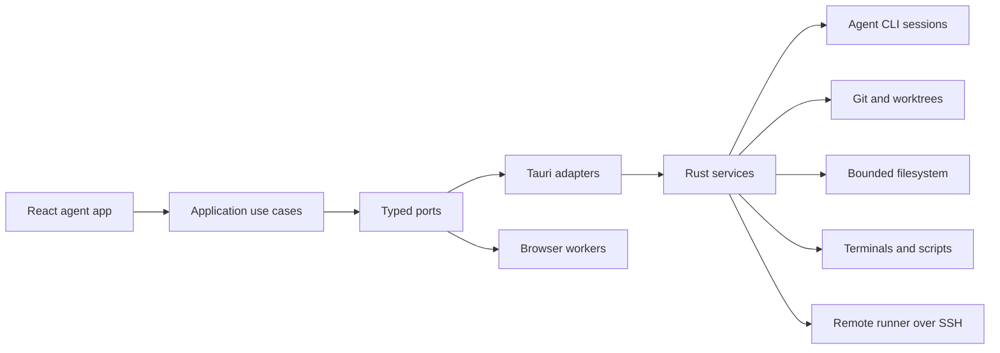

# Codevo Editor Project Plan

Date: 2026-10-15

Status: Active product plan

## Active Vision

Build a native desktop agent app, in the spirit of T3 Code, for running coding agents
(Claude Code, Codex) against local and remote projects. Developers start project-scoped
threads, follow the agent as it works, review the changes, and ship them without
leaving the app. The app should feel immediate while keeping strict workspace
ownership, bounded resource use, and native Rust services.

Codevo is not an IDE. The code editor (Monaco), LSP, Problems, test explorer, coverage,
eslint/prettier integration, PHP/JavaScript language intelligence, and the classic
workbench were removed by owner decision; do not reintroduce them unless the user
explicitly asks. The interactive debugger was removed earlier for the same reason.

This is a practical workflow target, not a parity claim with other agent apps or the
agent CLIs' own interfaces. Remote development, containers, an extension ecosystem,
and unsupported platforms are separate product-sized areas.

## Historical Context

The repository started as a Fleet-like, PHP-focused editor and later pursued VS Code
parity for JavaScript, TypeScript, Node.js, and Express. Both directions are
historical. `docs/archive/PROGRESS.md` and `docs/ARCHITECTURE_REVIEWS.md` keep that
record; do not use them to choose new work.

## Product Priorities

1. Fast, reliable agent threads: streaming transcripts, approvals, questions,
   steering, checkpoints, and notifications.
2. Safe checkouts: local checkout or isolated Git worktree, with exact project and
   thread ownership.
3. The right panel: terminal, read-only Files viewer, diff, Git, package scripts, pull
   request, history, and agents.
4. Review and shipping: commit, push, pull request, and worktree integration.
5. Settings, providers and MCP servers, the remote runner over SSH, and the updater.
6. Truthful degradation under hard limits instead of freezes or silent partial data.

## Architecture

Dependencies point inward. React, Tauri, workers, filesystem, processes, agent CLIs,
and SSH remain adapters around application and domain policies.

## Current Performance Contract

- Composer typing, transcript scrolling, thread switching, and panel switching must not
  wait for filesystem crawls, large diffs, Git, or agent process work.
- Expensive main-thread work moves to a browser worker or Rust blocking pool.
- Transcripts, viewer files, diffs, events, and cached owners have explicit caps and
  deterministic cleanup.
- Requests are cancellable and latest-owner-wins; A->B->A workspace reuse is a new
  generation, not permission for old work to publish.
- Large-content reductions are visible and do not leak to another thread or workspace.

## Near-Term Plan

1. Finish the IDE removal and full-gate validation.
2. Measure startup, bundle size, idle memory, and transcript/diff latency, then fix
   measured regressions without weakening ownership.
3. Close the highest-value gaps in agent threads, review, and shipping.
4. Harden the remote runner and the read-only remote Files viewer.

## Explicit Non-Goals For The Current Phase

- Reintroducing a code editor, language servers, Problems, test explorer, or coverage
  views.
- An extension marketplace, universal DAP, remote/container runtimes, or arbitrary
  executable launch recipes.
- Running unbounded parsing, diffing, or workspace scans on the UI thread.

## Completion Evidence

A slice is complete only after focused tests, independent review, applicable full
frontend and Rust gates, formatting, hotspot ratchets, and `git diff --check` pass.
Documentation records implemented behavior and unsupported scope; final counts are
published only from the lead's integrated gate run.
